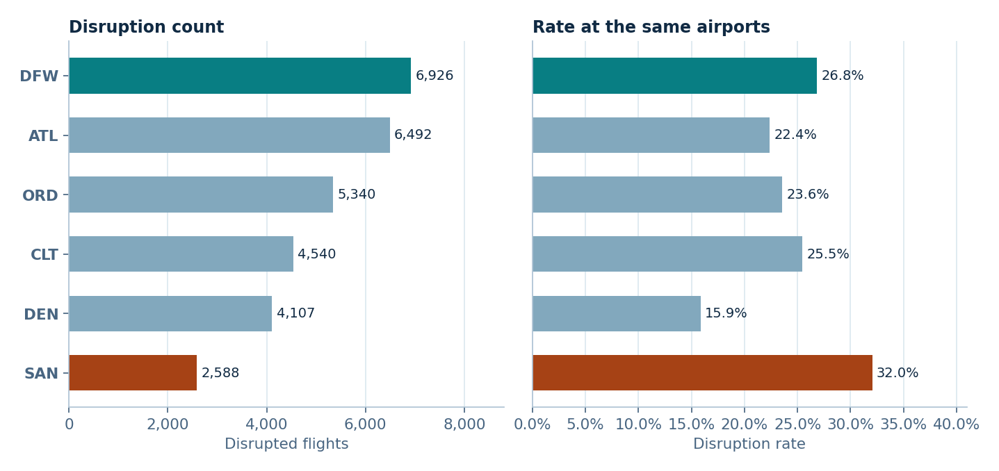

# Flight disruption: where should operations investigate first?

**Recommendation:** Start with scheduled departures from Dallas/Fort Worth (DFW) between 16:00 and 21:59 local time. In December 2024, 3,172 of 9,595 flights in that window were disrupted (**33.1%**), compared with **23.1%** at DFW during other hours. This is a recommendation for investigation, not a claim that moving flights earlier will fix the problem.

[Read the four-page findings report (PDF)](report/airline-reliability.pdf) · [Open the SQL results](outputs/) · [Read the analyst walkthrough](WALKTHROUGH.md)



## Decision and findings

Imagine an operations team has time for one reliability review. Which scheduled origin and time window should it investigate first? Choose by **affected flight volume** if the goal is reaching the most disrupted legs. Use **rate** if the goal is finding where an individual leg was most often disrupted.

| Question | December 2024 result |
|---|---|
| How big is the issue? | **129,470 / 590,581 (21.92%)** scheduled legs were disrupted: 123,721 late arrivals, 4,151 cancellations and 1,598 diversions. |
| When did the rate peak? | **December 29: 42.3%** (8,553 / 20,203). |
| Which local departure window had the highest rate? | **16:00–21:59: 27.9%**, vs. **16.3%** for 05:00–10:59. |
| Did the pattern persist when comparing the same carriers and routes? | **12.3 percentage points** higher in the evening using common weights across 3,711 eligible carrier-route groups. Descriptive, not causal. |
| Where would each decision rule lead? | **DFW** ranked #1 by count (**6,926**, 26.8%). **San Diego (SAN)** ranked #1 by rate (**32.0%**, 2,588) among the 57 origins with 2,000+ known outcomes, but #17 by count. |

## Data and definitions

BTS Reporting Carrier On-Time Performance, December 1–31, 2024: 590,581 scheduled nonstop domestic flight legs across 15 reporting carriers and 337 origin airports.[1][3] One row is one scheduled flight leg, including flights that were cancelled. This is not a passenger-level dataset or a complete census of all U.S. flights.

- **Disrupted** = arrived at least 15 minutes late, cancelled, or diverted. The denominator is all flights with a known outcome. A cancellation or diversion is known even if ordinary arrival delay is blank.[1]
- **Completed late rate** = late arrivals / completed non-diverted flights with known arrival delay. This gives 21.15%, not 21.92%. Both are valid because they answer different questions.
- **Departure window** = scheduled local time at the origin, not actual departure time. An actual departure time would be missing on some cancelled legs and could reassign late flights to the wrong schedule window.[1]
- **Origin grouping** describes where the flight was scheduled to depart, not where a disruption started. Airport volume rankings do not weight by passengers or severity.

## Reproduce

Use Python 3.11+ and SQLite 3.25+ (Python's `sqlite3` module). Tested on Python 3.11 / SQLite 3.38.4. The first run downloads a ~30 MB archive from BTS and verifies its SHA-256. The raw file and generated database stay local and are not committed.

```sh
python -m pip install -r requirements.txt
python -m unittest discover -s tests -v
python pipeline.py
python analyze.py
```

| File | What it does |
|---|---|
| `pipeline.py` | Streams the CSV from the ZIP, verifies schema and types, fingerprints entire source rows for duplicates, classifies the outcome and loads SQLite. |
| `sql/overview.sql` | Defines counts and denominators; start here to understand the KPI. |
| `sql/daily.sql`, `sql/daypart.sql` | Group outcomes by service date and scheduled local time window. |
| `sql/airports.sql`, `sql/focus.sql` | Rank origin airports by count and rate, then compare evening and other hours at the two leaders. |
| `sql/matched.sql` | Repeats the early/evening comparison on shared carrier-directional-route groups. |
| `analyze.py` | Runs read-only SQL, checks reconciliation, exports six tables, and draws three charts plus the PDF. |
| `outputs/audit.json` | Records the source checksum, 0 exact duplicates, 0 extra rows on the candidate key, and 590,581 retained rows. |

**Validation:** Daily and departure-window counts sum to the overall counts. The two airport drill-downs sum to their airport totals. The run also matches DOT Table 7A for 590,581 scheduled, 461,111 on-time, 4,151 cancelled and 1,598 diverted flights.[2] That is an external cross-check against published aggregates from the same reporting system, not a second independent dataset.

**Next decision:** Break down DFW evening by date, carrier, and directional route. Check whether the same segments recur in other months, then compare weather and inbound aircraft rotations before testing a schedule or staffing change. The observed rates cannot establish cause, avoidable flights or expected savings.

Personal portfolio case study. Initial implementation and report were AI-assisted. No airline commissioned the work and no operational impact is claimed.

## Sources

[1] https://www.transtats.bts.gov/Fields.asp?gnoyr_VQ=FGJ — BTS TranStats reporting carrier data dictionary

[2] https://www.transportation.gov/sites/dot.gov/files/2025-03/February%202025%20ATCR.pdf — DOT February 2025 Air Travel Consumer Report, Table 7A

[3] https://www.transtats.bts.gov/PREZIP/On_Time_Reporting_Carrier_On_Time_Performance_1987_present_2024_12.zip — BTS December 2024 source archive
